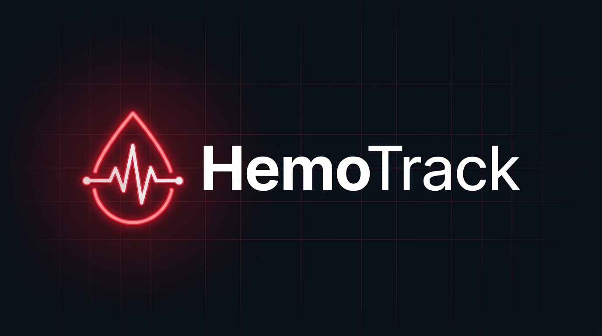
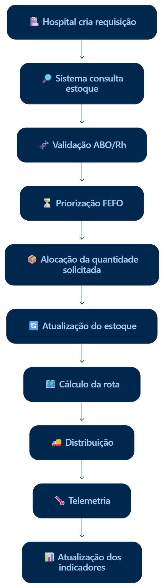
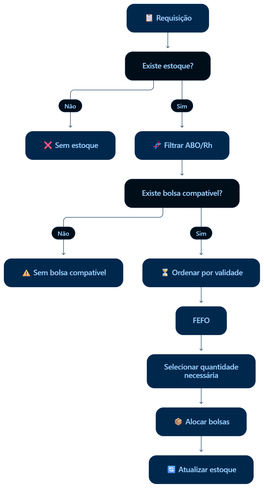
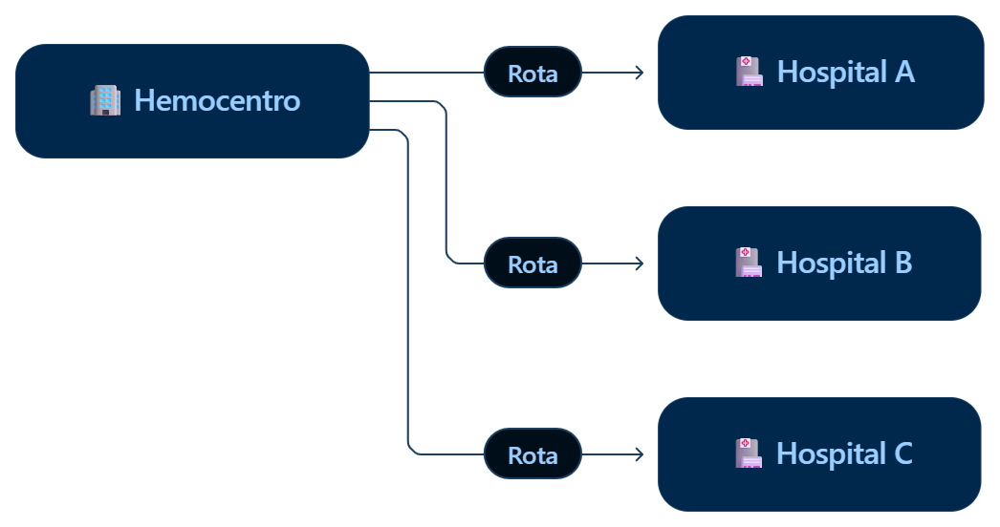
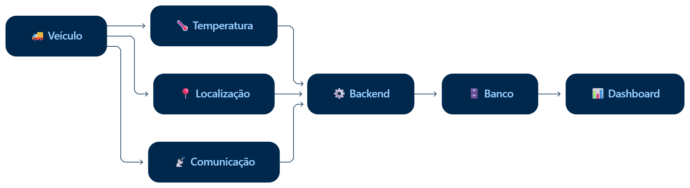
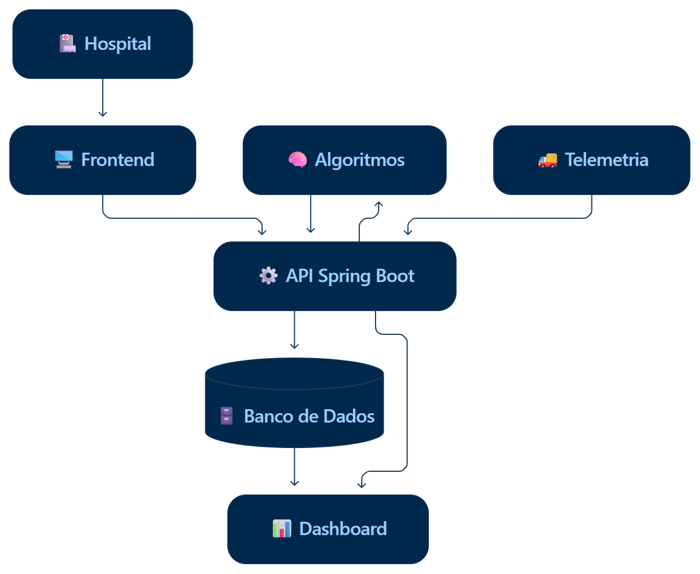
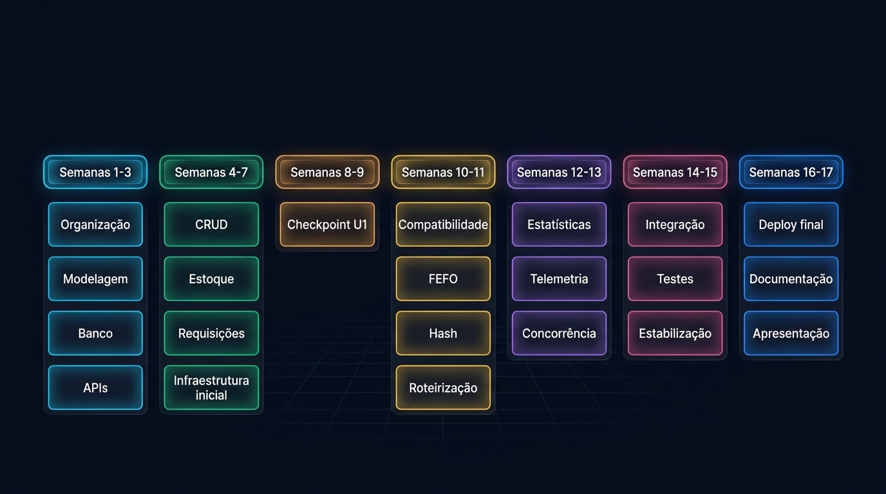

# 🩸 HemoTrack

### Gestão inteligente de hemocomponentes

Sistema web voltado ao gerenciamento de estoque, requisições hospitalares,
compatibilidade sanguínea, distribuição e monitoramento de hemocomponentes.

---

## 📌 Entregas do Projeto

    
---

### 🚀 Entrega 03 (19/10) POO

* *Histórias de Usuário (.MD):* [Acessar Documento de Histórias de Usuário](https://github.com/egs3-coder/HemoTrack/blob/main/historias.md)
* *Código (SRC):* [Acessar Código das Histórias Implementadas](https://github.com/egs3-coder/HemoTrack/blob/main/hemotrack.zip)
* *Screencast de Apresentação Visual (YouTube):* [Assistir Demonstração no YouTube](https://www.youtube.com/watch?v=9VsLCPvG6z4)
* *Screencast de Apresentação Código (YouTube):* [Assistir Demonstração no YouTube](https://www.youtube.com/watch?v=GqtDUjp6YH0)
    
---

## Issue/Bug Tracker

[🐞 Issue/Bug Tracker](https://github.com/egs3-coder/HemoTrack/issues)

---

## 🛠️ Tecnologias utilizadas

| | Tecnologia | Para que é usada no HemoTrack |
|:-:|---|---|
| ☕ | **Java 17** | Linguagem de todo o sistema: regras de negócio, entidades e serviços |
| 🌱 | **Spring Boot 3.3.5** (Web MVC) | Servidor web, controllers das telas e API REST do sensor de temperatura |
| 🗄️ | **Spring Data JPA + Hibernate** | Acesso ao banco: repositórios, consultas e controle de concorrência (`@Version`) |
| 💾 | **H2 Database** | Banco de dados gravado em arquivo (pasta `data`), sem instalar nada |
| 🖼️ | **Thymeleaf** | Páginas HTML geradas no servidor (login, painel, estoque, pedidos, dashboard) |
| ⏰ | **Spring Scheduling** | Rotina diária das 00:05 que descarta bolsas vencidas (US10) |
| 🔐 | **Java Security (PBKDF2)** | Senhas com hash e salt, código de recuperação e proteção CSRF, sem bibliotecas externas |
| 🎨 | **HTML5 + CSS3** | Layout responsivo das telas, cartões, gráficos de barras e etiquetas de status |
| ⚡ | **JavaScript** | Aviso em tempo real de usuário já existente e filtros da demanda preditiva |
| 🧪 | **JUnit 5 + Mockito + MockMvc** | Testes automatizados de cada cenário das histórias e de cada issue corrigida |
| 📦 | **Maven** | Build, dependências e execução dos testes (`mvn test`) |
| 🔀 | **Git + GitHub** | Versionamento do código e rastreamento de issues |
| ⚙️ | **C++17** | Versão das regras de negócio do sistema (requisição, estoque, alocação, rota, temperatura e demanda), portada do código Java |

---

## 📌 Sobre o projeto

O **HemoTrack** é uma aplicação desenvolvida para apoiar o controle e a
distribuição de hemocomponentes entre hemocentros e hospitais.

O sistema busca integrar, em um único fluxo:

- 🏥 requisições hospitalares;
- 🩸 controle de estoque;
- 🧬 compatibilidade ABO/Rh;
- ⏳ priorização FEFO;
- 🗺️ roteirização;
- 🌡️ telemetria;
- 📊 indicadores e dashboard.

---

## 👥 Equipe

<table align="center">
  <tr>
    <td align="center" width="220">
       
      <b>Ewerton Guilherme da Silva</b> 
      Product Owner
    </td>
    <td align="center" width="220">
       
      <b>Pablo Arthur Eustáquio de Lima</b> 
      Backend Developer
    </td>
    <td align="center" width="220">
       
      <b>João Ricardo Alves de Brito</b> 
      Backend Developer
    </td>
    <td align="center" width="220">
       
      <b>Lucas Aprigio dos Santos</b> 
      Backend Developer
    </td>
  </tr>
  <tr>
    <td align="center">
       
      <b>Saulo Eduardo Almeida dos Santos</b> 
      Backend Developer
    </td>
    <td align="center">
       
      <b>Thiago Cardozo da Conceição</b> 
      Frontend / UI Designer
    </td>
    <td align="center">
       
      <b>Eloi de Lima Sousa</b> 
      Frontend / UI Designer
    </td>
  </tr>
</table>

---

## 🎯 Objetivo

Desenvolver uma solução capaz de atender requisições hospitalares de forma
organizada, garantindo:

- disponibilidade de bolsas;
- seleção por compatibilidade sanguínea;
- priorização pela validade;
- alocação correta da quantidade;
- cálculo de rotas de distribuição;
- atualização de indicadores;
- monitoramento da telemetria.

---

## ⚙️ Funcionalidades principais

### 🏥 Gestão hospitalar
- cadastro de hospitais;
- consulta e atualização;
- controle de requisições.

### 🩸 Controle de estoque
- cadastro de bolsas;
- tipo sanguíneo e fator Rh;
- hemocomponente;
- validade;
- quantidade disponível;
- disponibilidade em estoque.

### 📋 Requisições
- hospital solicitante;
- hemocomponente;
- tipo sanguíneo;
- quantidade;
- nível de urgência;
- status da solicitação.

### 🧬 Inteligência do sistema
- compatibilidade ABO/Rh;
- priorização FEFO;
- alocação da quantidade correta;
- roteirização;
- atualização automática do estoque.

---

## 📊 Fluxo principal do sistema

  

---

## 🧠 Compatibilidade + FEFO

  

### Regra de alocação

Se houver:

- **2 bolsas disponíveis em estoque**
- e o hospital solicitar **1 bolsa**

o sistema deverá:

- alocar somente **1 bolsa**
- manter **1 bolsa restante no estoque**

---

## 🗺️ Distribuição

  

O **HemoTrack** também considera a etapa de distribuição, permitindo
organizar o envio de hemocomponentes do hemocentro para os hospitais.

---

## 🌡️ Telemetria

  

A telemetria permite acompanhar informações como:

- temperatura;
- localização;
- comunicação do transporte;
- envio dos dados para backend;
- persistência em banco;
- exibição em dashboard.

---

## 🏗️ Arquitetura geral

  

---

## 🚀 Etapas do desenvolvimento

### 1. Base do sistema
- modelagem;
- banco de dados;
- APIs;
- CRUD;
- estoque;
- requisições.

### 2. Inteligência
- compatibilidade ABO/Rh;
- FEFO;
- hash;
- roteirização.

### 3. Monitoramento
- estatísticas;
- telemetria;
- concorrência;
- dashboard.

### 4. Finalização
- integração;
- testes;
- estabilização;
- documentação;
- apresentação.

---

## 📅 Roadmap

  

---

## 🩸 HemoTrack

**Do estoque à entrega, informação para salvar tempo.**

